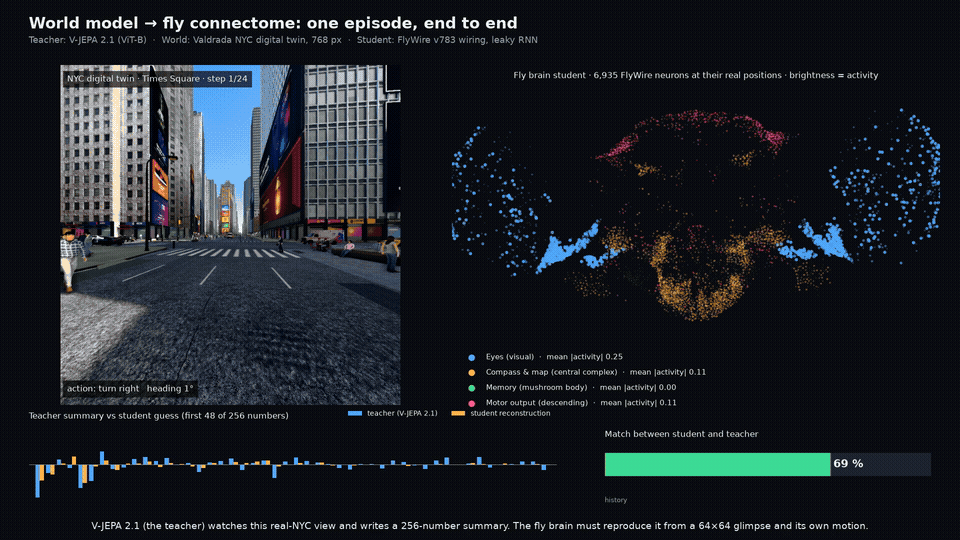
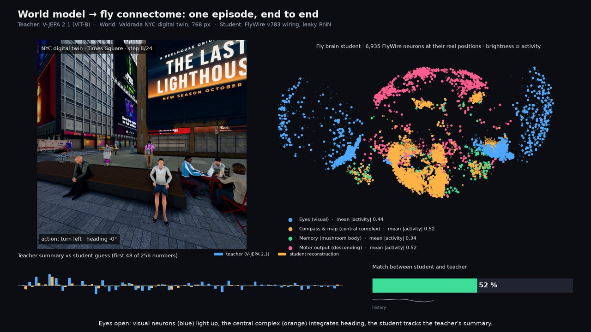
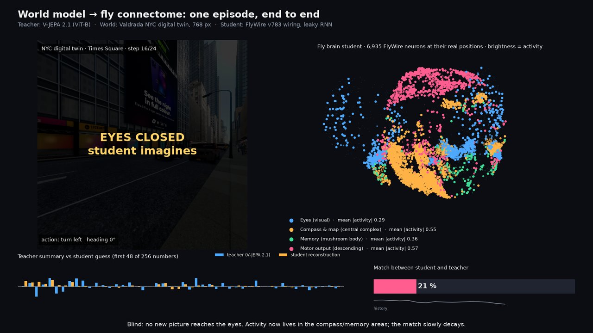
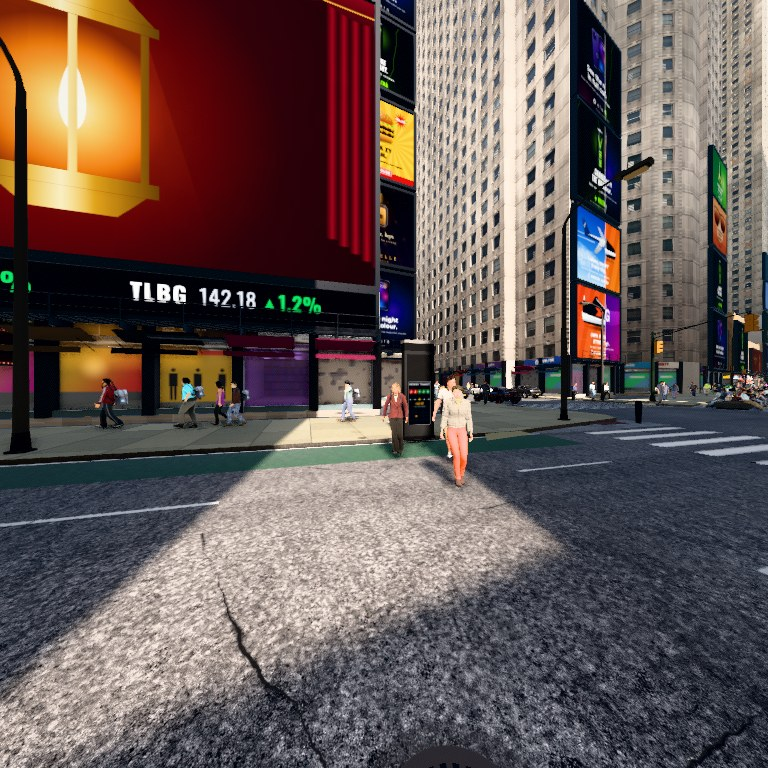
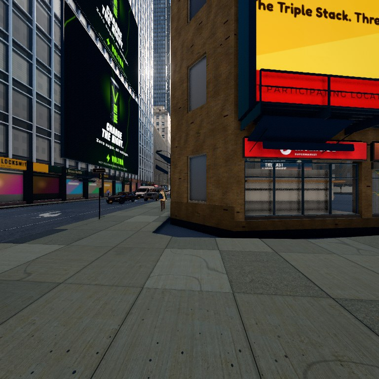
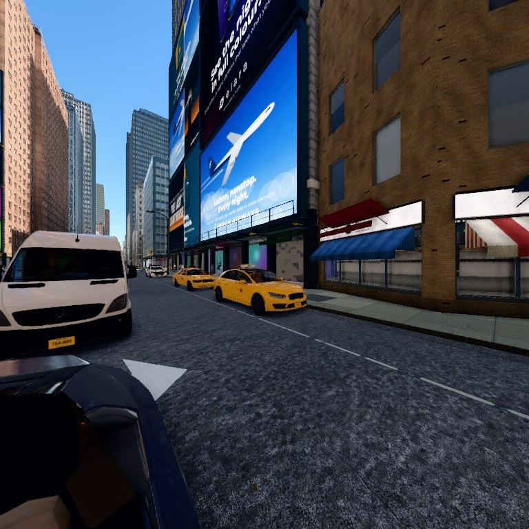
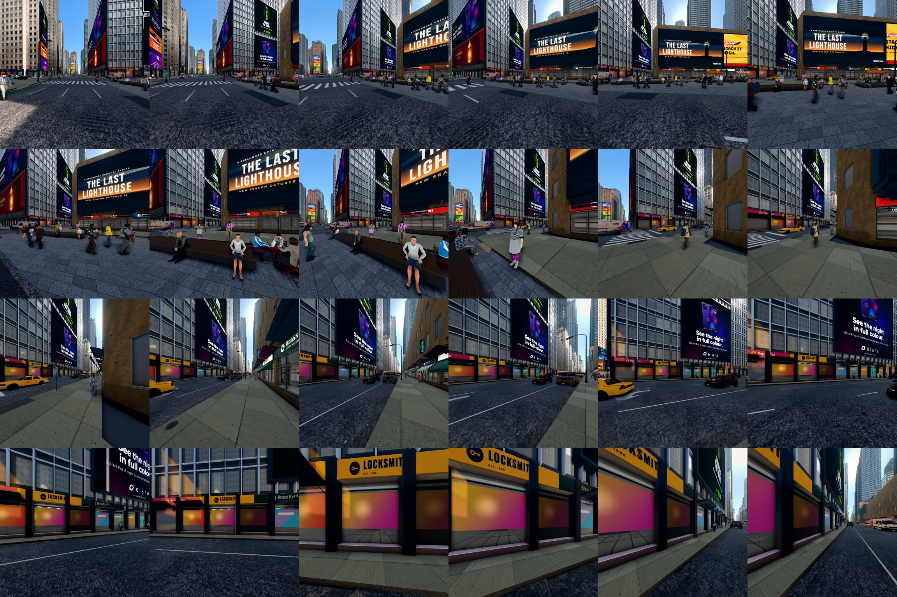

# World Model to Connectome Distillation (wm2cx)

Distilling a video world model (V-JEPA 2.1, ViT-B) into a recurrent student whose only recurrent wiring is
the FlyWire v783 Drosophila connectome (6,935 neurons across visual projection, central complex, mushroom-body
output and descending populations). See `PAPER_PLAN.md` for the claim, controls and experiment design.

## Pipeline
```
scripts/collect_all.sh     # synthetic NAV / ARRANGE episodes + per-step teacher latents -> data/*.npz
scripts/run_all.sh         # train all wirings, HD probes, planning evals (scripts/run_resume.sh skips finished runs)
scripts/summarize.py       # aggregate -> results/summary.md
```
Run everything with `PYTHONPATH=.` via `uv run`. Teacher weights load from `apiantonio/vjepa2.1-vit-base-384`
into the native transformers VJEPA2 encoder (see `wm2cx/teacher.py`).

## Record of run 1 (2026-10-28/29, M1 16 GB, MPS, 20 epochs, 1000 train / 200 test episodes)

### E1 Blind-horizon latent prediction (test; 8 visible steps, then 1..8 blind steps)
| wiring (K=1) | seeds | params | blind MSE (mean h1..h8) | cos | MSE h1 | MSE h8 |
|---|---|---|---|---|---|---|
| connectome (signed) | 2 | 7.25M | 0.625 ± 0.004 | 0.605 | 0.475 | 0.716 |
| connectome, no sign | 1 | 7.25M | 0.612 | 0.619 | 0.476 | 0.705 |
| degree-shuffled | 2 | 7.25M | 0.678 ± 0.002 | 0.562 | 0.538 | 0.773 |
| Erdos-Renyi random | 2 | 7.25M | 0.648 ± 0.004 | 0.579 | 0.557 | 0.751 |
| dense | 1 | 55.25M | 0.719 | 0.509 | 0.629 | 0.823 |
| GRU (1400 hidden) | 1 | 9.50M | 0.544 | 0.663 | 0.483 | 0.655 |

Reading: real wiring identity beats every degree/edge-matched sparse control and the dense net, with
seed variance an order of magnitude below the gaps. Removing Dale's-law signs does not hurt (slightly helps).
The parameter-matched GRU is the best predictor, especially at long horizons.

### E4 Multi-brain scaling (connectome, seed 0)
| K | neurons | params | blind MSE | cos |
|---|---|---|---|---|
| 1 | 6,935 | 7.25M | 0.629 | 0.602 |
| 2 | 13,870 | 14.50M | 0.621 | 0.610 |
| 3 | 20,805 | — | not completed: dense N×N state matrix swaps 16 GB RAM (epoch 9 after 1 h) | |

### E3 Head-direction / position linear probes (ridge; median heading error in degrees, R² in brackets)
| run | all, visible | all, blind | EPG, blind | CX, blind | position R², blind |
|---|---|---|---|---|---|
| connectome s0 | 16.7 (0.50) | 9.5 (0.82) | 47.0 (0.16) | 14.9 (0.69) | 0.49 |
| connectome s1 | 16.4 (0.50) | 9.4 (0.81) | 55.7 (0.06) | 17.4 (0.61) | 0.51 |
| connectome K=2 | 15.9 (0.52) | 9.6 (0.83) | 41.9 (0.19) | 11.3 (0.75) | 0.53 |
| connectome no sign | 22.4 (0.36) | 19.6 (0.57) | 36.5 (0.21) | 19.9 (0.52) | 0.38 |
| shuffled s0 / s1 | 16.8 / 17.3 | 11.0 / 10.4 | 37.4 / 41.7 | 11.3 / 11.6 | 0.48 / 0.50 |
| random s0 / s1 | 16.5 / 16.7 | 12.1 / 13.4 | 34.9 / 35.4 | 14.3 / 15.1 | 0.49 / 0.47 |
| dense | 32.8 (0.17) | 36.1 (0.35) | 50.3 (0.06) | 39.4 (0.27) | -0.14 |
| GRU | 30.1 (0.12) | 37.2 (0.29) | — | — | -0.05 |

Reading: sparse recurrent students path-integrate heading in the dark (about 10° median error) where dense
and GRU students do not (about 36°). The 51 EPG neurons alone carry almost no heading signal, so there is
no emergent ring attractor at this scale. Signs matter for the heading code even though they do not for MSE.

### E2 Teacher-free planning (latent CEM-MPC in the live arena, 30 episodes)
| policy | nav success | arrange success |
|---|---|---|
| scripted oracle | 1.00 | 0.93 |
| random actions | 0.07 | 0.00 |
| MPC, connectome K=1 | 0.03 | 0.00 |
| MPC, connectome K=2 | 0.07 | 0.00 |
| MPC, shuffled / random / dense / GRU | 0.03 each | 0.00 each |

Reading: the planner fails for every student, so E2 says nothing about wiring yet. Goal-latent encoding
and the 6-step CEM search need rework before this experiment is informative.

### Open items
1. Fix the MPC planner (E2) before any planning comparison.
2. Replace the materialised dense weight matrix in `FlyBrain.W()` with a sparse matmul so K=3 fits in memory.
3. Reconcile the GRU result: either a stronger student (more epochs, learnable time constants) or reframe
   the claim around the sparse-control comparison and the head-direction code.
4. `wm2cx/nyc.py` (NYC Midtown digital-twin arena from real building footprints) has no collect/eval path yet.

Full per-run numbers: `results/summary.md`; raw JSON in `results/runs`, `results/hd`, `results/plan`.

## End-to-end demo (NYC digital twin, high-quality render)



One held-out Times Square episode, start to finish: the view the teacher sees (left, 768 px Valdrada render with
ambient traffic and pedestrians), the trained connectome student's activity on real FlyWire soma positions (right,
blue = visual, orange = central complex, green = mushroom body, pink = descending), the teacher's latent summary next
to the student's reconstruction, and the match gauge. Steps 9–16 are blind: the view goes dark and the student imagines.
Full video: `results/video/wm2cx_nyc_e2e.mp4` (`scripts/make_video_e2e.py`, from `results/hq/` frames and
`results/brain3d.json`).

| eyes open (step 8) | eyes closed (step 16) |
|---|---|
|  |  |

What the world looks like at this quality setting (WebGL renderer, `quality=high`, photoreal pedestrians):



| | |
|---|---|
|  |  |

All 24 frames of the demo episode: 

Realism note: these are the simulator's real-time WebGL renders at the highest setting that runs on an M1 laptop. The
training data was collected at 256 px / medium quality. Valdrada also ships a Blender Cycles path-tracing exporter and a
UE5 client (Linux x86-64, ~30 GB) for true photorealism; neither was used here.

## Video: world model vs layered connectome
`scripts/make_video.py` replays a held-out navigation episode and renders, side by side, the 360° panorama the
teacher sees, the top-down path, the fly-eye input, teacher vs student latents, and the connectome student laid
out by layer (VIS → CX → MB → OUT) with every neuron coloured by its activity, plus an activity raster. A
degree-shuffled control is shown below the real wiring. Steps 8–15 are blind: the student imagines.
Output: `results/video/wm2cx_connectome.mp4` (and `.gif`, stills at `_t07.png` / `_t15.png`).
Explainable version for non-specialists: `scripts/make_video_explained.py` → `results/video/wm2cx_explained.mp4`
(title card, one narrated scene per step with plain-English captions, a "match %" gauge per brain, closing findings).

## NYC digital twin (Valdrada) — run 2, 2026-10-29
Real New York from [Valdrada](https://github.com/mkturkcan/valdrada): NYC building footprints + PLUTO attributes, street
centrelines, street furniture, rendered by its three.js/Electron simulator and driven over its CARLA-style Python API.
Setup: `scripts/valdrada_server.sh` (headless server at Times Square, 256×256, Metal on M1), arena `wm2cx/valdrada_env.py`
(same 5 discrete actions; agent = spectator with a forward 110° camera; walkability from the twin's surface query + planned
sidewalk route), data via `scripts/collect.py --env valdrada`, training via `scripts/run_nyc2.sh`.
Data: 120 train / 30 test episodes of 24 steps around Times Square (scripted-walker success 37 % within 24 steps).

| student (K=1, 30 epochs) | blind MSE h1 | h4 | h8 | mean | cos mean |
|---|---|---|---|---|---|
| connectome (real wiring) | 0.855 | 0.862 | 0.882 | **0.885** | **0.309** |
| degree-shuffled | 0.933 | 0.893 | 0.922 | 0.906 | 0.271 |
| Erdos-Renyi random | 0.975 | 0.889 | 0.932 | 0.917 | 0.262 |
| GRU (1400) | 1.024 | 0.834 | 0.946 | 0.907 | 0.280 |

Heading probe (median error, deg; visible / blind): connectome 19.7 / 30.0, shuffled 24.6 / 27.3, random 27.6 / 32.7,
GRU 48.6 / 45.5. The task is much harder than the synthetic arena (120 episodes, 110° view instead of 360°, real
clutter): absolute prediction quality is low for every student, but the real wiring is best at every horizon, and here it
also beats the GRU, which was not the case on the synthetic arena. One seed only; needs more data and seeds.
Video: `results/video/wm2cx_nyc_explained.mp4` (`scripts/make_video_explained.py --data data/nyc_test.npz ...`).

## Web pages
- `docs/explainer.html`: plain-language five-scene explainer with results (also published at https://claude.ai/artifact/W8qroZnbBSigaW2W3CGW1P).
- `docs/world_brain_split.html`: world view and 3D brain side by side on one shared step slider, Times Square episode at 768 px (https://claude.ai/artifact/86AKeF8BLACdNqbENmv2BB). Built by `scripts/build_split_page.py`.
- `docs/brain3d.html`: interactive 3D replay of the trained student on real FlyWire neuron positions, teacher latent vs reconstruction, scroll chapters and personal notes (https://claude.ai/artifact/4TuHXcWNksMpqvrSr9VxDL). Built by `scripts/build_brain3d_page.py` from an export of positions + activity.
