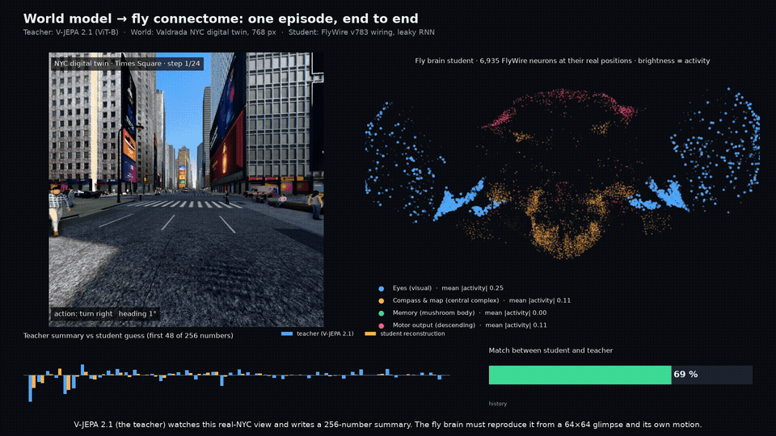
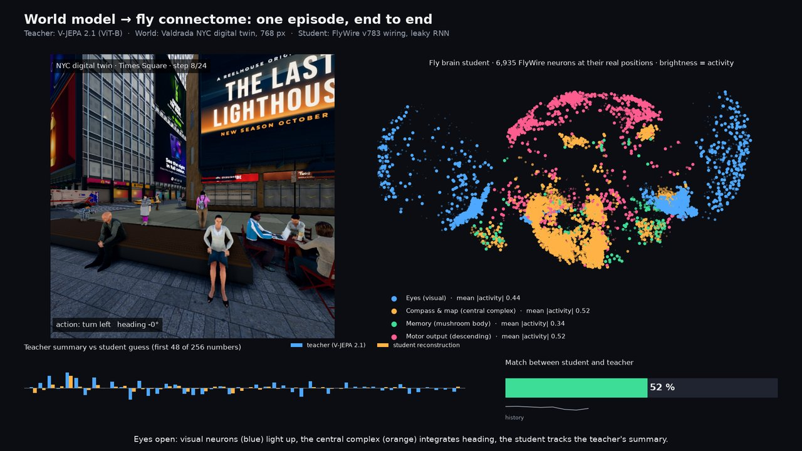
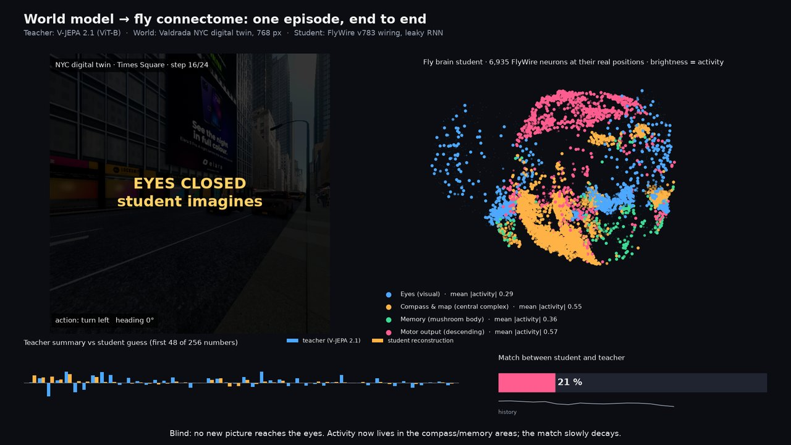
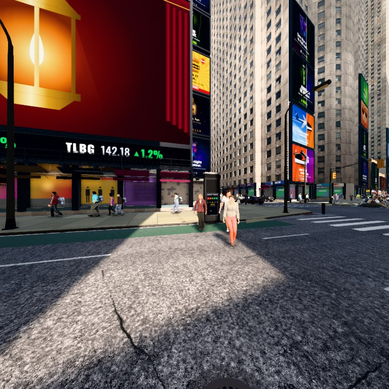
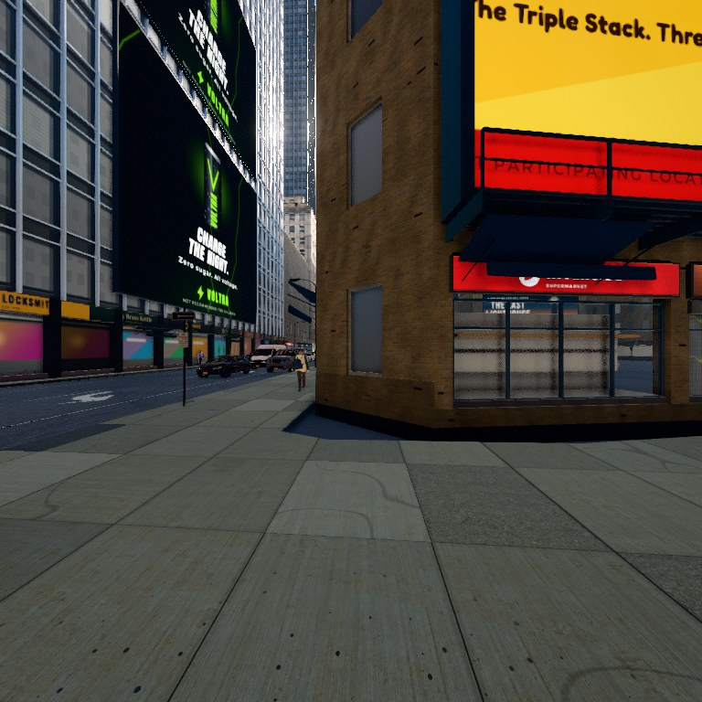
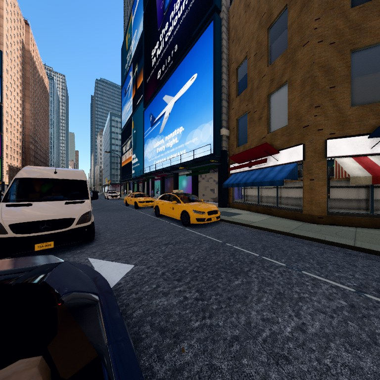
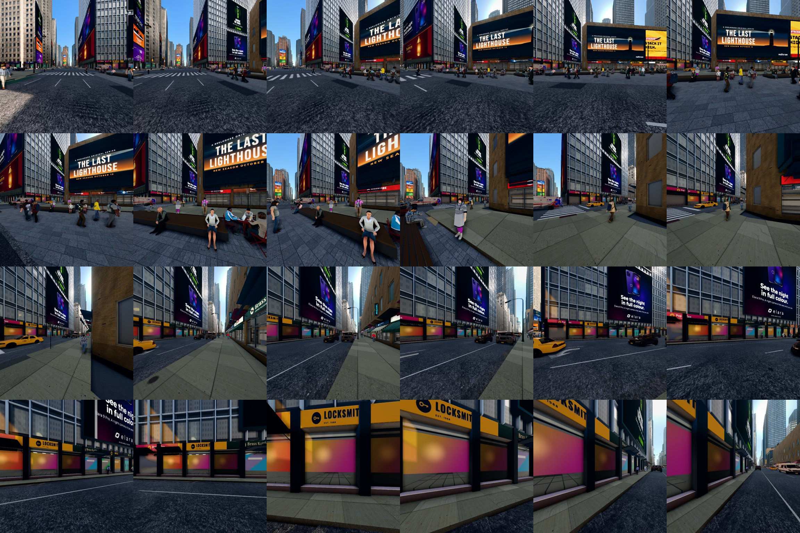
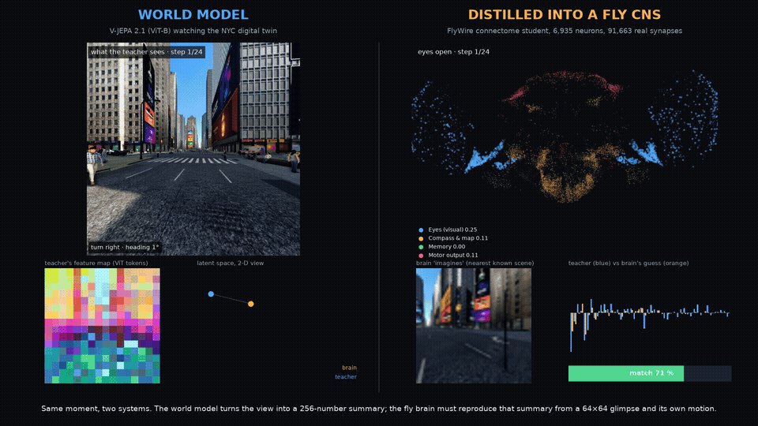
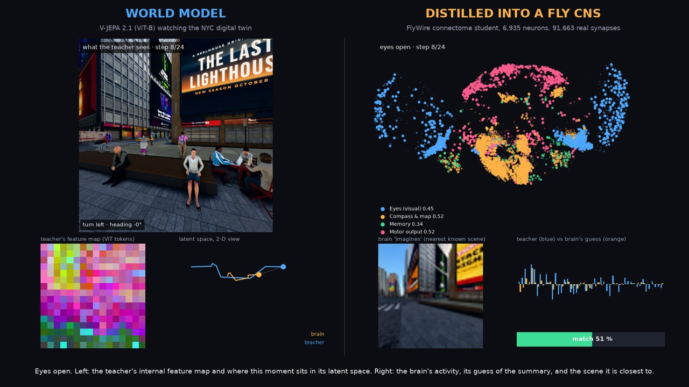
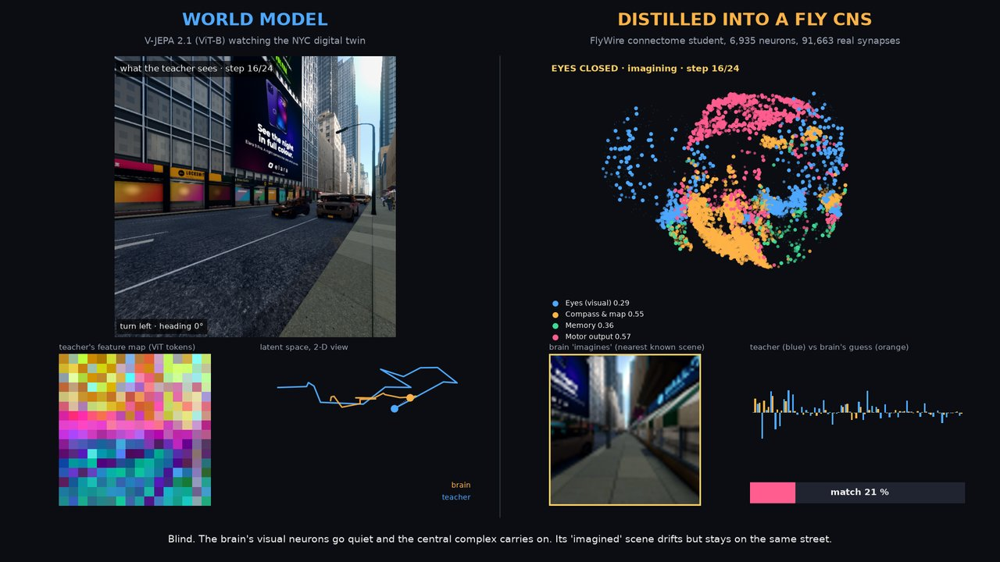

# World Model to Connectome Distillation (wm2cx)

Distilling a video world model (V-JEPA 2.1, ViT-B) into a recurrent student whose only recurrent wiring is
the FlyWire v783 Drosophila connectome (6,935 neurons across visual projection, central complex, mushroom-body
output and descending populations). See `PAPER_PLAN.md` for the claim, controls and experiment design.

**Continuing on another machine (M1):** read `docs/HANDOFF_M1.md` first. It lists where every file lives (git, Kaggle),
what each result means, and how to rerun the figures, videos and probes with `--device mps`. The CVPR-format paper is in
`paper/`; the two explainer videos are `results/video/wm2cx_paper.mp4` (arena) and `results/video/wm2cx_realvid.mp4`
(the real phone clips).

## Pipeline
```
scripts/collect_all.sh     # synthetic NAV / ARRANGE episodes + per-step teacher latents -> data/*.npz
scripts/run_all.sh         # train all wirings, HD probes, planning evals (scripts/run_resume.sh skips finished runs)
scripts/summarize.py       # aggregate -> results/summary.md
```
Run everything with `PYTHONPATH=.` via `uv run`. Teacher weights load from `apiantonio/vjepa2.1-vit-base-384`
into the native transformers VJEPA2 encoder (see `wm2cx/teacher.py`).

## Record of run 1 (2026-10-28/29, M1 16 GB, MPS, 20 epochs, 1000 train / 200 test episodes)

### E1 Blind-horizon latent prediction (test; 8 visible steps, then 1..8 blind steps)
| wiring (K=1) | seeds | params | blind MSE (mean h1..h8) | cos | MSE h1 | MSE h8 |
|---|---|---|---|---|---|---|
| connectome (signed) | 2 | 7.25M | 0.625 ± 0.004 | 0.605 | 0.475 | 0.716 |
| connectome, no sign | 1 | 7.25M | 0.612 | 0.619 | 0.476 | 0.705 |
| degree-shuffled | 2 | 7.25M | 0.678 ± 0.002 | 0.562 | 0.538 | 0.773 |
| Erdos-Renyi random | 2 | 7.25M | 0.648 ± 0.004 | 0.579 | 0.557 | 0.751 |
| dense | 1 | 55.25M | 0.719 | 0.509 | 0.629 | 0.823 |
| GRU (1400 hidden) | 1 | 9.50M | 0.544 | 0.663 | 0.483 | 0.655 |
| *trivial: constant train mean* | – | 0 | 1.043 | – | | |
| *trivial: copy last visible latent* | – | 0 | 0.97–1.19 | – | | |

Reading: real wiring identity beats every degree/edge-matched sparse control and the dense net, with
seed variance an order of magnitude below the gaps. Removing Dale's-law signs does not hurt (slightly helps).
The parameter-matched GRU is the best predictor, especially at long horizons. Every student is well below both
trivial predictors on the arena (connectome 0.625 vs 1.04 constant mean); the trivial rows were recomputed in the
same PCA-256 space and blind window (`scripts/eval_trivial.py`, #6). All numbers above are in whitened PCA space;
`scripts/summarize.py` now also reports MSE in the original 3,840-d teacher space, bootstrap 95% CIs over test
episodes and paired tests vs the connectome for every run that stores per-episode errors (`scripts/train.py`
does since #8; the run-1 JSONs do not, so those columns read "-" until `scripts/run_seeds.sh` is rerun with
5 seeds per condition).

### E4 Multi-brain scaling (connectome, seed 0)
| K | neurons | params | blind MSE | cos |
|---|---|---|---|---|
| 1 | 6,935 | 7.25M | 0.629 | 0.602 |
| 2 | 13,870 | 14.50M | 0.621 | 0.610 |
| 3 | 20,805 | — | not completed: dense N×N state matrix swaps 16 GB RAM (epoch 9 after 1 h) | |

### E3 Head-direction / position linear probes (ridge; median heading error in degrees, R² in brackets)
| run | all, visible | all, blind | EPG, blind | CX, blind | position R², blind |
|---|---|---|---|---|---|
| connectome s0 | 16.7 (0.50) | 9.5 (0.82) | 47.0 (0.16) | 14.9 (0.69) | 0.49 |
| connectome s1 | 16.4 (0.50) | 9.4 (0.81) | 55.7 (0.06) | 17.4 (0.61) | 0.51 |
| connectome K=2 | 15.9 (0.52) | 9.6 (0.83) | 41.9 (0.19) | 11.3 (0.75) | 0.53 |
| connectome no sign | 22.4 (0.36) | 19.6 (0.57) | 36.5 (0.21) | 19.9 (0.52) | 0.38 |
| shuffled s0 / s1 | 16.8 / 17.3 | 11.0 / 10.4 | 37.4 / 41.7 | 11.3 / 11.6 | 0.48 / 0.50 |
| random s0 / s1 | 16.5 / 16.7 | 12.1 / 13.4 | 34.9 / 35.4 | 14.3 / 15.1 | 0.49 / 0.47 |
| dense | 32.8 (0.17) | 36.1 (0.35) | 50.3 (0.06) | 39.4 (0.27) | -0.14 |
| GRU | 30.1 (0.12) | 37.2 (0.29) | — | — | -0.05 |

Reading: sparse recurrent students path-integrate heading in the dark (about 10° median error) where dense
and GRU students do not (about 36°). The 51 EPG neurons alone carry almost no heading signal, so there is
no emergent ring attractor at this scale. Signs matter for the heading code even though they do not for MSE.

Caveat (#7): turns are discrete and fixed-angle (±22.5°) and the one-hot action is fed to CX/OUT neurons, so
relative heading equals 22.5° × (#left − #right) and any leaky integrator of the action input exposes it linearly.
The table above also uses 6,935 features for FlyBrain vs 1,400 for the GRU. `scripts/eval_hd.py` now reports an
`actions only` ridge (cumulative action counts, no neural state) and an `all@1400` feature-matched probe next to every
run; a population only "encodes heading" if it beats the action-only floor. These columns are empty for run 1 until
the probes are rerun. `scripts/collect.py --turn_noise 0.3` makes turn angles continuous so integration is non-trivial.

### E2 Teacher-free planning (latent CEM-MPC in the live arena, 30 episodes)
| policy | nav success | arrange success |
|---|---|---|
| scripted oracle | 1.00 | 0.93 |
| random actions | 0.07 | 0.00 |
| MPC, connectome K=1 | 0.03 | 0.00 |
| MPC, connectome K=2 | 0.07 | 0.00 |
| MPC, shuffled / random / dense / GRU | 0.03 each | 0.00 each |

Reading: the planner fails for every student, so E2 says nothing about wiring yet. Goal-latent encoding
and the 6-step CEM search need rework before this experiment is informative.

Planner validation ladder (#9, `scripts/eval_plan.py --dynamics ...`): `oracle` (ground-truth state, cost = goal
distance) isolates the CEM search; `render_teacher` / `render_student` (ground-truth rollouts, frames encoded by the
teacher or by the student with eyes open) isolate the latent goal cost; `student` is the teacher-free number. On the
arena the oracle search solves NAV 10/10 (goal distance 5.6 → 1.0; horizon 8, 3 CEM iterations, 64 candidates), so the
search is not the failure. It still solves ARRANGE 0/6 at horizon 8: pushing needs longer coordinated sequences, so
that task fails for reasons unrelated to any student. `--goal_mode pose` encodes one frame at the goal pose instead of
the nearest of 8 headings; `--horizon`, `--iters`, `--n_cand` are exposed. The remaining student-dynamics runs need the
checkpoints (not in the repo).

### Open items
1. Fix the MPC planner (E2) before any planning comparison.
2. Replace the materialised dense weight matrix in `FlyBrain.W()` with a sparse matmul so K=3 fits in memory.
3. Reconcile the GRU result: either a stronger student (more epochs, learnable time constants) or reframe
   the claim around the sparse-control comparison and the head-direction code.
4. `wm2cx/nyc.py` (NYC Midtown digital-twin arena from real building footprints) has no collect/eval path yet.

Full per-run numbers: `results/summary.md`; raw JSON in `results/runs`, `results/hd`, `results/plan`.

## Run 2 (2026-11-04, AWS L4): transformer baseline, attention input, hybrid routing, continuous turns

`scripts/run_l4.sh` reruns the arena / NYC-twin protocol with three additions, all parameter-matched (#4):
`--wiring transformer` (causal pre-LN transformer predictor, `wm2cx/transformer.py`), `--in_mode attn` (cross-attention
input encoder, `AttnInput` in `wm2cx/student.py`, which removes the dead input parameters) and `--hybrid 1` (one attention
layer over cell-type-pooled activity on top of the connectome recurrence). A second copy of the arena data is collected
with `--turn_noise 0.3` (`data/*_tn_*.npz`, runs tagged `_tn`) so that heading is no longer a linear function of the
action counts. Tables land in `results/summary.md` as before.

`docs/distill3d.html` (built by `scripts/build_distill_page.py` from `results/brain3d.json`) is an interactive three.js
walk through the pipeline, layer by layer, for a general audience.

Real-video stage (queued behind run 2): `scripts/run_l4_realvid.sh` evaluates every arena, attention-input and NYC-twin
checkpoint on `data/realvid_all.npz` (9 phone clips, 82 episodes: the 8-clip Kaggle mirror plus one clip ingested 2026-11-04; mirror `popsensharma/world2brain-realvid`,
file `realvid_all_z.npz`): zero-shot (`_realvid`), leave-one-clip-out fine-tuning (`_realvid_ft`), and heading probes with
a simulator-fit (`_rv_transfer`) or clip-fit (`_rv_indomain`) readout. Results land in the same tables via `summarize.py`.

## End-to-end demo (NYC digital twin, high-quality render)



One held-out Times Square episode, start to finish: the view the teacher sees (left, 768 px Valdrada render with
ambient traffic and pedestrians), the trained connectome student's activity on real FlyWire soma positions (right,
blue = visual, orange = central complex, green = mushroom body, pink = descending), the teacher's latent summary next
to the student's reconstruction, and the match gauge. Steps 9–16 are blind: the view goes dark and the student imagines.
Full video: `results/video/wm2cx_nyc_e2e.mp4` (`scripts/make_video_e2e.py`, from `results/hq/` frames and
`results/brain3d.json`).

| eyes open (step 8) | eyes closed (step 16) |
|---|---|
|  |  |

What the world looks like at this quality setting (WebGL renderer, `quality=high`, photoreal pedestrians):



| | |
|---|---|
|  |  |

All 24 frames of the demo episode: 

Realism note: these are the simulator's real-time WebGL renders at the highest setting that runs on an M1 laptop. The
training data was collected at 256 px / medium quality. Valdrada also ships a Blender Cycles path-tracing exporter and a
UE5 client (Linux x86-64, ~30 GB) for true photorealism; neither was used here.

## Two videos in sync: world model vs the fly-CNS student



Left, the world model itself: V-JEPA 2.1 watching the NYC twin, its ViT patch-feature map (tokens projected to PCA
colours) and where each moment sits in its latent space. Right, the distilled student: activity of the 6,935 FlyWire
neurons, its reconstruction of the teacher's 256-number summary, and the training scene whose teacher latent is nearest
to the student's guess (what the brain "imagines"). The 2-D latent plot shows both trajectories and how they diverge
during the blind steps and re-converge afterwards.
Full video: `results/video/wm2cx_nyc_duel.mp4` (`scripts/make_video_duel.py`; runs the teacher on the 768 px frames).

| eyes open (step 8) | eyes closed (step 16) |
|---|---|
|  |  |

## Video: world model vs layered connectome
`scripts/make_video.py` replays a held-out navigation episode and renders, side by side, the 360° panorama the
teacher sees, the top-down path, the fly-eye input, teacher vs student latents, and the connectome student laid
out by layer (VIS → CX → MB → OUT) with every neuron coloured by its activity, plus an activity raster. A
degree-shuffled control is shown below the real wiring. Steps 8–15 are blind: the student imagines.
Output: `results/video/wm2cx_connectome.mp4` (regenerate with the script; not kept in the repo since 2026-11-01).
Explainable version for non-specialists: `scripts/make_video_explained.py` → `results/video/wm2cx_explained.mp4` (not kept)
(title card, one narrated scene per step with plain-English captions, a "match %" gauge per brain, closing findings).
Issue-sweep explainer (#6–#13), the one video kept in the repo: `scripts/make_video_issues.py` →
`results/video/wm2cx_issues_explained.mp4` (7:35, narrated; one still per scene `_s00..10.png`; `--gif` for a preview). One scene per issue with the numbers the repo holds (E1 curves vs trivial
baselines, seed spread, heading-probe controls, planner ladder with oracle dynamics, NYC protocol, Table 3), narrated
offline with Windows SAPI when available (`--no_audio` otherwise); needs only the committed JSON/PNG results, not `data/`.

## NYC digital twin (Valdrada) — run 2, 2026-10-29
Real New York from [Valdrada](https://github.com/mkturkcan/valdrada): NYC building footprints + PLUTO attributes, street
centrelines, street furniture, rendered by its three.js/Electron simulator and driven over its CARLA-style Python API.
Setup: `scripts/valdrada_server.sh` (headless server at Times Square, 256×256, Metal on M1), arena `wm2cx/valdrada_env.py`
(same 5 discrete actions; agent = spectator with a forward 110° camera; walkability from the twin's surface query + planned
sidewalk route), data via `scripts/collect.py --env valdrada`, training via `scripts/run_nyc2.sh`.
Data: 120 train / 30 test episodes of 24 steps around Times Square (scripted-walker success 37 % within 24 steps).

| student (K=1, 30 epochs) | blind MSE h1 | h4 | h8 | mean | cos mean |
|---|---|---|---|---|---|
| connectome (real wiring) | 0.855 | 0.862 | 0.882 | **0.885** | **0.309** |
| degree-shuffled | 0.933 | 0.893 | 0.922 | 0.906 | 0.271 |
| Erdos-Renyi random | 0.975 | 0.889 | 0.932 | 0.917 | 0.262 |
| GRU (1400) | 1.024 | 0.834 | 0.946 | 0.907 | 0.280 |
| *trivial: constant train mean* | | | | 0.977 | |
| *trivial: copy last visible latent* | | | | 1.46–1.64 | |

**This is a pilot, not a result.** The connectome student is only 9 % better than predicting the training mean
(0.885 vs 0.977), with one seed and 30 test episodes from a single location (Times Square), a random episode split and
no appearance variation; copy-last is *worse* than the mean because the 110° view changes a lot per step. Heading
probe (median error, deg; visible / blind): connectome 19.7 / 30.0, shuffled 24.6 / 27.3, random 27.6 / 32.7,
GRU 48.6 / 45.5. The task is much harder than the synthetic arena (120 episodes, 110° view instead of 360°, real
clutter): absolute prediction quality is low for every student; the real wiring is nominally best at every horizon
and here also beats the GRU, but none of these gaps has a confidence interval yet. Needs ≥3 seeds, ≥3 locations with
a geographic train/val/test split, and scaled collection before any claim is made (#8, #10).

Run 3 on a GPU box: `scripts/aws_h100.sh` (stages `seeds hd plan bench ablate`, restartable) runs everything that still
needs compute, including the data-efficiency axis (`train.py --n_train 50|100|200|500`, connectome vs shuffled vs GRU,
3 seeds, summarised as E6) that tests whether the connectome prior beats the GRU where a prior should matter.

Benchmark protocol for run 3 (#10, tooling in place, data not yet collected):
- `scripts/collect_nyc_multi.sh`: four locations (Times Square, Flatiron, FiDi, Upper West Side), one server restart
  per location, then `scripts/split_geo.py`, which assigns whole 120 m blocks of start positions to train / val / test
  (70 / 15 / 15) *before* training and reports the minimum train–test trajectory distance (`--margin 40` drops test
  episodes closer than that). Collection speed (80 s/episode on the M1) is the bottleneck; a GPU box or the Windows /
  UE5 client is needed for ≥1,000 episodes.
- Closed-loop blackout: `scripts/eval_plan.py --env nyc --blackout {1,3,5} --blackout_trigger obstacle` cuts the
  controller's vision for 1/3/5 steps at the first obstacle encounter (building ahead) and reports success, SPL
  (shortest grid path to the 12 m success radius / path travelled) and collisions per 100 m. Oracle/render planners are
  denied actions during the blackout so only the student can imagine through it.
- Appearance shifts: `NYCArena(appearance=clear|overcast|fog|dusk|night)` (fog distance, sun azimuth, sky colour, light
  level) for train-on-clear / test-on-shift evaluation; `--appearance` on `eval_plan.py`.
Video: `scripts/make_video_explained.py --data data/nyc_test.npz ...` → `results/video/wm2cx_nyc_explained.mp4` (not kept in the repo).

Raycast twin without Valdrada (`wm2cx/nyc.py`, 2026-10-31): `scripts/fetch_nyc_data.sh` downloads the inputs that were
missing from the repo (686 Midtown footprints with roof height and construction year from NYC Open Data `5zhs-2jue`,
823 OSM street ways from Overpass, ~0.9 × 0.8 km around Times Square) into `data/nyc/`; `scripts/render_nyc_twin.py`
renders the five appearance shifts from one pose and a scripted episode with a 3-step blackout (`results/nyc_twin/`,
~30 ms per 256 px panorama on CPU, so collection is not GPU-bound here). The grid shortest path used by SPL is now an
8-connected Dijkstra (4-connected BFS overestimated diagonal avenues by up to 41 % and clipped SPL to 1). Planner runs
on the twin need no checkpoint (`eval_plan.py --env nyc --policy scripted | --dynamics oracle --blackout N
--blackout_trigger fixed`, 10 episodes, 40 steps, goals 40–90 m, CEM horizon 8 / 64 candidates / 3 iterations):

| controller on the twin | blackout (steps, from step 8) | success | SPL | collisions / 100 m |
|---|---|---|---|---|
| scripted (walkability-grid waypoints) | 0 | 0.90 | 0.89 | 0.0 |
| scripted | 3 | 0.90 | 0.89 | 3.3 |
| CEM-MPC, oracle dynamics | 0 | 1.00 | 0.99 | 0.0 |
| CEM-MPC, oracle dynamics | 1 | 1.00 | 0.98 | 0.0 |
| CEM-MPC, oracle dynamics | 3 | 1.00 | 0.98 | 0.0 |
| CEM-MPC, oracle dynamics | 5 | 0.80 | 0.78 | 0.0 |

Blind controllers take random actions (the scripted policy reads env state, so it is denied too), which is where the
collisions come from; the oracle planner re-plans after the blackout and absorbs up to 3 blind steps. These are the
search-side ceilings for E2 on the twin: the student-dynamics rows still need checkpoints trained on twin episodes.

## Issue fixes merged from the M1 branch (2026-11-01; GitHub issues #1-#5, see `PAPER_ISSUES.md`)
The M1 session fixed issues #1-#5 on `results/nyc-videos-and-benchmarks` while main fixed #6-#13; the two lines are now
one codebase (main's tooling, the branch's controls and protocol). What changed in the model and protocol:

| issue | fix | where |
|---|---|---|
| #1 block structure | `shuffled` is a Maslov-Sneppen switch rewire (exact edge count, every in/out-degree, no self-loops); new `block_shuffled` keeps every (pre-region, post-region) block count | `wm2cx/rewire.py`, `student.build_edges` |
| #2 signs | every control takes one sign per presynaptic neuron (Dale) with the inhibitory *edge* fraction matched to the real 0.50; new `connectome_randsign` (same softplus parametrisation, permuted neurotransmitter identity) | `student.dale_signs` |
| #3 parameters | `W_in` feeds the 2,330 VIS neurons only (3.7M total for K=1, 2.5 % recurrent, down from 7.25M with 66 % dead rows); `param_breakdown()` in every run JSON; optional `--in_rank` bottleneck | `student.py`, `train.py` |
| #4 GRU matching | `--gru_hidden 0` (default) picks the largest GRU with <= the FlyBrain parameter count; both models receive the blackout flag (`--vis_flag`); `--val` carves a validation split for the lr sweep (`aws_h100.sh` stage `lr`); the old 1,400-unit GRU stays as `gru_big` | `student.gru_hidden_for`, `run_seeds.sh` |
| #5 causal targets | `collect.py --causal 1` (default): the target at step t is the latent of the clip ending at t, so blind-window targets no longer encode the frames the student cannot see (8x teacher cost); `ingest_video.py` does the same; each npz records `meta.causal` and `aws_h100.sh` stage `data` re-collects the arena when the files are non-causal | `scripts/collect.py` |
| checkpoints | one loader, `wm2cx/ckpt.py`, rebuilds any run (legacy dense-mask / full-W_in checkpoints convert on load) | all eval and video scripts |

Consequence for every table above: they were produced with non-causal targets, the global shuffle and the 7.25M-parameter
student, and are superseded by the GPU rerun (`scripts/aws_h100.sh`, stages `data lr seeds hd plan bench ablate realvid`).
Data for the rerun: the FlyWire raw files, `connectome.npz` and the run-1 episode files are on Kaggle
(`popsensharma/world2brain-flywire-783`, private); the arena is re-collected causally on the GPU box, the NYC Valdrada
episodes stay as a legacy non-causal set, and the raycast twin (`collect.py --env nyc`) provides a causal NYC set with the
geographic block split (`split_geo.py`).

## E7 Real handheld video (2026-11-01, tooling + pilot data)
`scripts/ingest_video.py` turns unlabeled phone / GoPro footage into wm2cx episodes: centre square crop to 256 px, 2 steps/s,
egomotion from a 4x4 patch-grid phase correlation (pure numpy) accumulated over 4 sub-frames per step, yaw in degrees via the
horizontal FoV and radial expansion as a forward-motion proxy, quantised to the arena's five actions (continuous values kept
in `ego`, integrated yaw in `heading` for the E3 probe). `scripts/eval_ckpt.py` evaluates any checkpoint on such a file in the
checkpoint's own PCA space, zero-shot or with leave-one-clip-out fine-tuning, and writes train.py-compatible JSON plus the
trivial predictors for the same episodes, so `summarize.py` shows E7 as its own tables (`_realvid`, `_realvid_ft`). Pilot:
3 clips, 95 s, 11 overlapping episodes (`data/realvid_all.npz`, not committed); teacher latents are added on the GPU box
(`--from_npz ... --device cuda`), and `scripts/aws_h100.sh` stage `realvid` runs every K=1 checkpoint through it.
`scripts/vast_launch.sh` rents one RTX 4090 on Vast.ai and drives the GPU script end to end.

## Spotlight roadmap (2026-11-05): what the evidence says and what is still missing

Run 2 arena numbers (3 seeds, blind latent MSE at horizon 1 / 8, lower is better): connectome 0.419 / 0.709,
block-shuffled 0.426 / 0.711, random (ER) 0.459 / 0.690, transformer 0.402 / 0.611, GRU 0.348 / 0.525. Attention
input and the hybrid layer do not move the connectome. Read plainly: **on prediction, synapse-level identity buys
nothing measurable** (1.5 % over block-shuffled at h1, tied at h8, behind random wiring at h8), and every
parameter-matched free architecture is well ahead. The paper's positive claim lives entirely in the state probes
(heading / position decodable during blind windows), blind homing, and the real-video transfer. Those numbers are the
the `\TODO` macros in `paper_v2/main.tex` (num_pending block) and come from stages `hd homing` + `run_l4_realvid.sh` of run 2.

Status today: a careful analysis paper with a clean negative on prediction and a mechanistic positive on the state.
That is main-track material, not a spotlight. The items below are ordered by leverage; 1-3 are this submission,
4-9 are the next cycle.

| # | item | why it matters | cost | status |
|---|---|---|---|---|
| 1 | Finish run 2 (`tn nyc hd homing summary`, then realvid) and regenerate `num.tex` | the only positive claim has no numbers yet | tonight, L4 | running |
| 2 | Reframe abstract / intro around the negative prediction result + the state finding; state the h8 tie with random wiring | reviewers will rebuild the MSE table | 1 day | open (#17) |
| 3 | Unidirectional LSTM at the same budget, 3 seeds | pre-empts "why only GRU"; expected within noise of GRU | 15 min, L4 | open (#24) |
| 4 | A task the connectome **wins**, not just encodes: blind homing on continuous turns, longer blackouts (8:24, 4:24), heading under action noise | a spotlight needs an outright win against the matched GRU | 1-2 days | partly in run 2 (#18) |
| 5 | Closed-loop navigation on real scenes: 3D Gaussian splat twins of the phone clips (COLMAP + Splatfacto/gsplat), env wrapper, planner with blackout stretches, SPL / success / collision; fix the goal-latent cost first (0 % even with oracle dynamics) | the computer-vision result a CVPR audience expects; the one place dead-reckoning state can beat raw prediction | 1-2 weeks | open (#20, #9) |
| 6 | A distillation objective that uses the structure: auxiliary dead-reckoning loss on CX only, or a contrastive across-blackout term; report as a design, not a by-product | turns "heading is decodable" into "the circuit was trained as a path integrator" | 1 day each | open (#21) |
| 7 | Scale the claim beyond one graph: ablation stage on the new controls (min_syn 1 / region sets), K=1-3 with CIs, a second connectome (larval CNS or hemibrain) | "one graph, one species" is the first attack | 2-3 GPU days | open (#19) |
| 8 | Larger teacher (ViT-L, 384 px) and a second real-odometry dataset (RECON / SCAND) for the real-video stage | removes the single-teacher and flow-estimated-action caveats | 1-2 GPU days + data | open (#22) |
| 9 | Graph neural network student on the real edges (vector node state, typed message MLP, same budget), run on all three wirings | gives the real graph capacity without changing who talks to whom; separates capacity from wiring | 1 week, L4 | open (#23, Atharva) |

### Owners (2026-11-05)

| work | owner | issue | where to start |
|---|---|---|---|
| Run 2 on the L4 (tn, nyc, probes, homing, real video) and `num.tex` | Prajak | #1-#13 | `scripts/run_l4.sh`, `scripts/make_paper_tables.py` |
| Blackout Navigation part B (T2 Continue, T3 Re-entry, figures, seed top-up) | Prajak | #18 | `docs/BENCHMARK_BLACKOUT.md` section 8 |
| Closed-loop navigation on the NYC digital twin (planner goal cost, blackout-in-the-loop) | Prajak | #9 done 2026-11-05 (oracle 0.83, connectome 0.18, GRU 0.11, random wiring 0.06) | `scripts/run_l4_goalnav.sh`, `results/summary.md` E10 |
| Blackout Navigation benchmark (spec `docs/BENCHMARK_BLACKOUT.md`): part A sweeps | Atharva | #18 | `scripts/eval_homing.py`, `scripts/eval_hd.py`, run 2 `_tn` / `_b8_24` outputs |
| Graph neural network student (message passing on the connectome) | Atharva | #23 | `wm2cx/student.py` (`FlyBrain`), `wm2cx/transformer.py` as the template for a new `--wiring` |
| Closed-loop navigation on real crowded-scene video (splat twins of the phone clips) | Priyanshi | #20 | `scripts/ingest_video.py`, `data/realvid_all.npz`, `wm2cx/env.py` interface |
| LSTM baseline at the same budget | Priyanshi | #24 | `scripts/train.py --wiring gru` path, `wm2cx/student.py::gru_hidden_for` |
| Reframe abstract / intro around the negative result | Amitava sir | #17 | `paper_v2/main.tex` (abstract and introduction blocks) |

### Graph neural network student (for Atharva; issue #23)

**What the student is now.** One sparse recurrent layer: `h_{t+1} = (1-a) h_t + a tanh(g (W h_t + W_in o_t + W_act a_t + b))`
with `W` an edge list of 91,663 signed scalars (`W_ij = s_ij softplus(w_ij)`, sign fixed). In GNN terms that is already
one round of message passing per time step with a *scalar* message (`w_ij * h_j`), sum aggregation and a tanh node
update. Everything a GNN adds is on top of that: vector node states, learned message functions, type-aware edges.

**What to build: `--wiring gnn` in `scripts/train.py`, class `FlyGNN` in `wm2cx/student.py`.**
1. Node state `h_i in R^d` with `d` in {4, 8, 16} per neuron instead of a scalar (6,935 x d).
2. Message on each real edge `m_ij = s_ij * softplus(w_ij) * phi(h_j)` where `phi` is a small MLP shared across edges
   of the same (pre cell type, post cell type) pair; keep the sign fixed so Dale's law survives. Sum-aggregate with
   `index_add` exactly as the edge-list code does now (`FlyBrain.step`), so cost stays O(E d).
3. Node update: GRU cell or `tanh` MLP per cell type (`h_i' = GRUCell(m_i + W_in o_t[i] + W_act a_t[i], h_i)`),
   shared parameters per type so the count stays small.
4. Readout: same linear map from the concatenated state (6,935 d -> 256); for d > 1 pool with a per-type linear first
   so the readout does not become the whole budget.
5. Parameter accounting must match the other cores (3.71 M total) via `param_breakdown`; shrink `d` or share more until it does.

**Controls that make it a result, not a demo.** Run the same GNN on `connectome`, `block_shuffled`, `random`: if the GNN
beats the GRU only on the real graph the wiring matters; if it beats the GRU on all three, the gain is the message
function, not the connectome. Both outcomes are publishable, but they are different papers. Also report `d = 1` with
the learned `phi` (is it the vector state or the message MLP that helps?).

**Why it could be the outright win (#18).** The scalar student loses to the GRU because its only free parameters on the
graph are 91,663 magnitudes; the GRU has 0.7 M recurrent weights. A GNN gives the real graph vector capacity while
keeping which neurons talk to which. If sum-aggregated typed messages on the CX ring recover heading *and* prediction,
the paper has its win. If they do not, the finding "capacity on the real graph still loses" is the cleaner negative.

**Order of work (about one week on the L4).** (i) `FlyGNN` with `d=1`, learned `phi`, check it reproduces the scalar
numbers when `phi` is identity; (ii) `d=8`, 3 seeds, arena; (iii) the three wirings; (iv) probes and homing through the
existing `eval_hd.py` / `eval_homing.py` (they take a checkpoint and a state, so nothing changes); (v) `tn` data.
Tests go in `tests/test_student.py` next to the existing ones. Message-passing references to cite: Gilmer 2017 (MPNN),
Battaglia 2018 (graph networks), Sanchez-Gonzalez 2020 (learned simulators); for biology-constrained GNNs,
Lappalainen 2024 (connectome-constrained fly visual model).

Non-goals until 5 works: appearance shifts, latency tables, humanoid transfer. Issue register: `PAPER_ISSUES.md` section F.

## Web pages
- `docs/explainer.html`: plain-language five-scene explainer with results.
- `docs/world_brain_split.html`: world view and 3D brain side by side on one shared step slider, Times Square episode at 768 px. Built by `scripts/build_split_page.py`.
- `docs/brain3d.html`: interactive 3D replay of the trained student on real FlyWire neuron positions, teacher latent vs reconstruction, scroll chapters and personal notes. Built by `scripts/build_brain3d_page.py` from an export of positions + activity.
